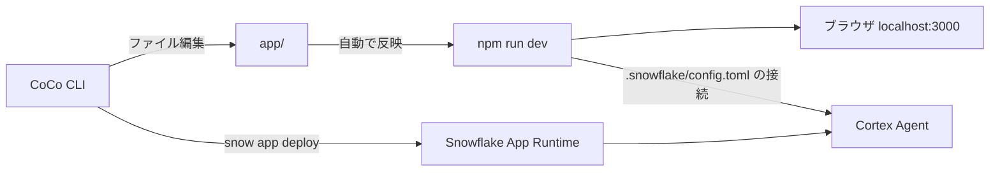

# スノー生命 法人営業 AI アプリ ハンズオン（CoCo CLI 編）

架空の生命保険会社「スノー生命」の法人営業アシスタント（Cortex Agent）を Web アプリに組み込み、CoCo CLI に日本語で指示しながら画面を作って、Snowflake App Runtime にデプロイするハンズオンです（90 分）。

前回のハンズオン [snowlife-corporate-sales-handson](https://github.com/sfc-gh-kmotokubota/snowlife-corporate-sales-handson) の続編です。前回の到達点（データ・セマンティックビュー・Cortex Agent・業務スキル）は `catchup.sql` で自動的に作るので、前回に参加していなくても始められます。

## 必要なもの

| もの | 用途 |
|---|---|
| Snowflake トライアルアカウント（AWS 東京） | AI 機能と Snowflake App Runtime を有効にしたもの |
| CoCo CLI（`cortex`） | AI と対話してアプリのコードを作る |
| Snowflake CLI（`snow`）3.29 以上 | 環境構築とアプリのデプロイ |
| Node.js（LTS） | アプリを手元で動かす |

インストール方法は、別途お送りするセットアップガイドを参照してください。

## はじめかた

1. このリポジトリを `Code` » `Download ZIP` でダウンロードして展開する
2. `setup_win.bat` をダブルクリックする（Mac はターミナルで展開したフォルダに移動し、`bash setup_mac.command`。インターネットから取得した `.command` は Gatekeeper によりダブルクリックでは開けません）
   - 前提チェック → 接続設定（PAT の自動生成）→ 環境構築（`catchup.sql`、約 5 分）→ CoCo CLI の起動、まで自動で進みます
3. 別ウィンドウで `start_dev_win.bat`（Mac は `bash start_dev_mac.command`）を実行し、`http://localhost:3000` を開く
4. [handson/app_cli.md](handson/app_cli.md) の手順に沿って進める

## フォルダ構成

```
snowlife-app-handson/
├── README.md
├── AGENTS.md                 CoCo CLI が最初に読む作業ルール
├── setup_win.bat             Windows: 前提チェック・接続・環境構築・CoCo CLI 起動
├── setup_mac.command         macOS: 同上
├── start_dev_win.bat         Windows: アプリを localhost:3000 で起動
├── start_dev_mac.command     macOS: 同上
├── catchup.sql               環境の一括構築（sql/ から生成）
├── cleanup.sql               後片付け
├── sql/                      catchup.sql の元ファイル
├── tools/build_catchup.py    sql/ から catchup.sql を作る
├── app/                      Next.js アプリ（Cortex Agent のチャット画面と app.yml）
├── data/                     CRM 相当の CSV と PDF（catchup.sql が GitHub から取り込む）
├── skills/  answers/skills/  Cortex Agent の業務スキル（SKILL.md）
├── handson/app_cli.md        ハンズオン手順とお題プロンプト
└── organizer/checklist.md    主催者向けチェックリスト
```

## 仕組み



- 接続設定（PAT を含む）は、このフォルダの `.snowflake/` に作られます。PC の `~/.snowflake/` には触れません。`.snowflake/` は `.gitignore` 済みです。
- CoCo CLI は、個人の設定や MCP サーバーを読み込まない状態（`--setting-sources project --no-mcp`）で起動します。

## 注意

- 本リポジトリのデータはすべて架空です。
- `sql/` を変更したら `python3 tools/build_catchup.py` で `catchup.sql` を作り直してください。
