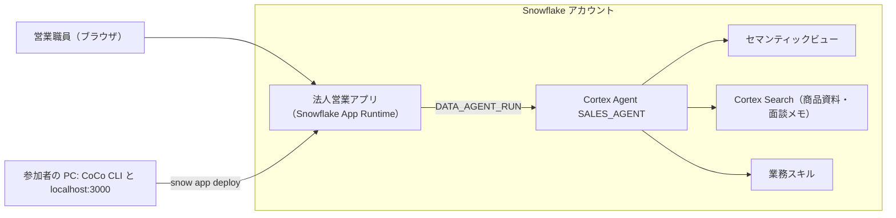

# CoCo CLI で Cortex Agent アプリを作る（90 分）

前回のハンズオンで作った法人営業アシスタント（Cortex Agent）を、Web アプリに組み込みます。CoCo CLI に日本語で指示しながら画面を作り、Snowflake App Runtime で社内向けに公開するところまで体験します。

## このハンズオンで作るもの



## Why Snowflake

- **データの外にアプリを出さない**: アプリは Snowflake の中（App Runtime）で動きます。顧客データを別のサーバーへコピーせずに画面を作れます。
- **権限はいつもの Snowflake のロール**: アプリを使える人も、Agent が見られるデータも、Snowflake のロールと行アクセスポリシーで決まります。
- **作る道具も Snowflake を知っている**: CoCo はテーブル・セマンティックビュー・Agent の中身を理解したうえでコードを書きます。

## 当日の流れ

| 時間 | 内容 |
|---|---|
| 0〜15 分 | STEP 1: セットアップ（接続・環境構築・CoCo CLI 起動） |
| 15〜25 分 | STEP 2: アプリを手元で動かす |
| 25〜65 分 | STEP 3: CoCo CLI と一緒にアプリを育てる |
| 65〜80 分 | STEP 4: Snowflake にデプロイする |
| 80〜90 分 | まとめ |

---

## STEP 1: セットアップ（15 分）

1. GitHub からこのリポジトリを ZIP でダウンロードし、デスクトップなど分かりやすい場所に展開します。
   - `Code` » `Download ZIP`
2. 展開したフォルダ（`snowlife-app-handson-main`）でセットアップを始めます。
   - **Windows**: `setup_win.bat` をダブルクリックします。
   - **Mac**: ターミナルを開き、`cd `（最後に半角スペース）と入力してから、展開したフォルダをターミナルにドラッグして Enter を押します。続けて `bash setup_mac.command` と入力して Enter を押します。
     - インターネットから取得した `.command` は、macOS の安全機能（Gatekeeper）によりダブルクリックでは開けません。
     - 「ターミナルが「デスクトップ」フォルダ内のファイルにアクセスしようとしています」と表示されたら「許可」を押します。
3. 前提チェックがすべて `[OK]` になることを確認します。
4. 聞かれた順に入力します。
   - アカウント識別子（Snowsight 左下のアイコン » 「Connect a tool to Snowflake」で確認。例: `ABCDEFG-XY12345`）
   - ユーザ名（ログイン名）
   - パスワード（入力しても画面には表示されません）
5. 「環境を構築しています（約 5 分）」と表示されたら待ちます。この間に、講師が作るものの全体像を説明します。
6. CoCo CLI が起動したら、最初にテーマの選択などを聞かれるので、画面の案内に従って進めます。
7. 動作確認として、次の文を貼り付けて送ります。

```
このフォルダに何があるか、そして今日つかう Cortex Agent が何をできるかを、初心者向けに 5 行で説明してください。
```

> **うまくいかないとき**: `[NG]` が出たらセットアップガイドの該当ページを見てインストール・更新してください。接続に失敗した場合は、アカウント識別子とパスワードを確認して `setup_win.bat` をもう一度実行します。

## STEP 2: アプリを手元で動かす（10 分）

1. CoCo CLI のウィンドウはそのままにして、もう 1 つウィンドウを開きます。
   - **Windows**: 展開したフォルダで `start_dev_win.bat` をダブルクリックします。
   - **Mac**: ターミナルで Command + N を押して新しいウィンドウを開き、STEP 1 と同じように `cd ` と入力してフォルダをドラッグし、Enter を押します。続けて `bash start_dev_mac.command` と入力して Enter を押します。
2. 初回は部品のインストールに 1〜3 分かかります。
3. ブラウザで `http://localhost:3000` が開きます（開かない場合は自分で開いてください）。
4. 画面のサンプル質問ボタンを押し、Agent が答えることを確認します。答えまで 20 秒ほどかかります。

この時点で、ウィンドウは次の 3 つです。

| ウィンドウ | 役割 |
|---|---|
| CoCo CLI | 日本語で指示して、アプリのコードを書き換えてもらう |
| dev サーバー（`start_dev_win.bat`） | アプリを手元で動かす。エラーが出たらここに表示される |
| ブラウザ（localhost:3000） | 作っているアプリの画面。保存すると自動で更新される |

## STEP 3: CoCo CLI と一緒にアプリを育てる（40 分）

CoCo CLI に次のお題を 1 つずつ貼り付けて送り、ブラウザで変化を確認します。順番どおりでなくても構いません。うまくいかなかったら、dev サーバーのウィンドウのエラーをそのまま CoCo に貼り付けて「直してください」と頼みます。

### お題 1: 見た目を整える（5 分）

```
アプリのタイトルを「スノー生命 法人営業アシスタント」に変え、画面の文言をすべて日本語にしてください。ロゴもこのアプリに合うシンプルな SVG に作り変えてください。
```

### お題 2: 担当顧客のダッシュボードを足す（15 分）

```
トップページの上部に、商談パイプラインのサマリーを追加してください。SNOWLIFE_HANDSON_DB.RAW.SF_OPPORTUNITY をもとに、商談ステージ（名称は MST_STAGE）ごとの件数と見込み金額（AMT_EST）の合計を、カードとグラフで表示してください。列の意味はセマンティックビュー AI.SV_SALES_ANALYTICS の定義を参考にし、実データを SQL で取得してください。
```

### お題 3: Agent への質問をワンクリックにする（10 分）

```
ダッシュボードの取引先名をクリックすると、その企業について「訪問前ブリーフィングを作って」と Agent に自動で質問するようにしてください。
```

### お題 4: 自由課題（10 分）

自分の業務で欲しい機能を、CoCo に相談しながら追加してみましょう。例:

- 「回答の中の金額を見やすく表にして」
- 「Agent が使った SQL を、営業職員にも分かる説明付きで表示して」
- 「よく聞く質問をボタンにして、画面の左側に並べて」

> **ポイント**: 一度に大きく頼むより、「まず○○だけ」「次に△△を」と小さく区切ると、CoCo が確実に作れます。

## STEP 4: Snowflake にデプロイする（15 分）

1. CoCo CLI に次の文を送ります。

```
アプリを Snowflake にデプロイしてください。
```

2. CoCo がデプロイ先を示して確認してくるので、「はい」と返事をします。
3. CoCo が `snow app deploy` を実行します。初回は 3〜5 分ほどかかります（Snowflake 上でアプリを組み立てています）。
4. 表示された URL（`https://〜.snowflakecomputing.app`）をブラウザで開き、Snowflake にログインします。
5. 手元と同じように Agent が答えることを確認します。

> 画面を直したら、もう一度「デプロイして」と頼むと、同じ URL のまま更新されます。

## まとめ

- **CoCo CLI**: Snowflake の中身を理解したうえで、日本語の指示からアプリのコードを書く
- **Cortex Agent**: 前回作った業務の知識（セマンティックビュー・スキル）を、そのままアプリから使える
- **Snowflake App Runtime**: アプリをデータと同じ場所で動かし、Snowflake のログインとロールで守る

## 後片付け

ハンズオンで作ったものを削除するときは、CoCo CLI に次の文を送ります。

```
catchup.sql と同じフォルダにある cleanup.sql の内容を説明してから実行してください。
```
