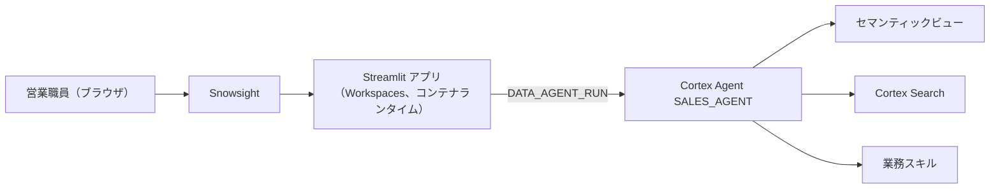

# Plan B: Snowsight の CoCo で Streamlit アプリを作る

本編（CoCo CLI × Snowflake App Runtime）が進められないときの代わりの進め方です。PC へのインストールは不要で、ブラウザ（Snowsight）だけで完結します。追加のセットアップ SQL も不要です（`catchup.sql` で作った Agent とデータをそのまま使います）。

## 構成



- **コンテナランタイムで動かすこと**: ウェアハウスランタイムの Streamlit からは Cortex Agent を呼べません。トライアルアカウントには `DEFAULT_STREAMLIT_COMPUTE_POOL = SYSTEM_COMPUTE_POOL_CPU` が最初から設定されています。
- Agent は SQL 関数 `SNOWFLAKE.CORTEX.DATA_AGENT_RUN` で呼びます（本編のアプリと同じ）。

## 手順

1. Snowsight で **Projects » Workspaces** を開き、**+ Add new » Streamlit app** を選びます。
2. 画面右の CoCo（Cortex Code）パネルを開き、下のプロンプトを 1 つずつ送ります。
3. ファイルが更新されたら **Run** で画面を確認します。
4. できあがったら **Deploy** を押し、次を選びます。
   - Location: `SNOWLIFE_HANDSON_DB.APP`
   - Execution: コンピュートプール `SYSTEM_COMPUTE_POOL_CPU`、クエリウェアハウス `SNOWLIFE_HANDSON_WH`

## プロンプト

### ① チャット画面

```
この Streamlit アプリ（コンテナランタイム）を、Cortex Agent SNOWLIFE_HANDSON_DB.AI.SALES_AGENT に質問できるチャット画面に作り変えてください。
- Agent は SQL 関数 SNOWFLAKE.CORTEX.DATA_AGENT_RUN を session.sql で呼び、質問はバインド変数（params）で渡してください。リクエストには "stream": false を指定します。
- 回答は、最後のツール呼び出し・思考より後にある text と table を順番どおりに表示してください（table は st.dataframe で）。
- 使ったツールと実行された SQL は、折りたたみで表示してください。
- サンプル質問のボタンを 3 つ置き、画面の文言はすべて日本語にしてください。
```

### ② パイプラインのダッシュボード

```
画面の上部に、商談パイプラインのサマリーを追加してください。SNOWLIFE_HANDSON_DB.RAW.SF_OPPORTUNITY をもとに、商談ステージ（名称は MST_STAGE）ごとの件数と見込み金額（AMT_EST）の合計を、st.metric と棒グラフで表示してください。列の意味はセマンティックビュー SNOWLIFE_HANDSON_DB.AI.SV_SALES_ANALYTICS の定義を参考にし、実データを SQL で取得してください。
```

### ③ 取引先をワンクリックで質問

```
ダッシュボードに、進行中の商談の見込み金額が大きい取引先トップ 10 を表示してください。取引先名のボタンを押すと、その企業について「訪問前ブリーフィングを作って」と Agent に自動で質問し、チャット欄に回答を表示するようにしてください。
```

## 参考実装

CoCo がうまく作れなかったときは、[streamlit_app.py](streamlit_app.py)（プロンプト①の完成形）と [pyproject.toml](pyproject.toml) の中身を Workspaces のファイルに貼り付けて **Run** してください。
